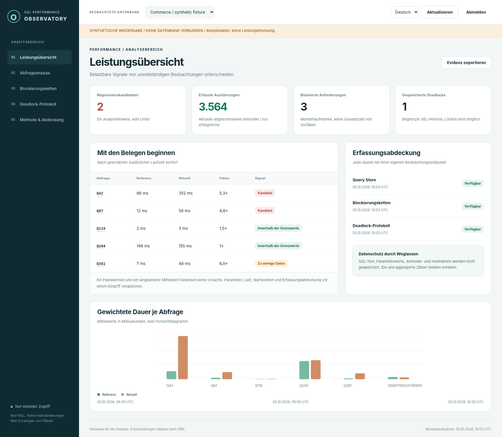

# SQL Server Performance Observatory

**Verlangsamungen verstehen. Die Kontrolle über Eingriffe behalten.**

[English](README.md) · [Architektur](docs/de/architecture.md) · [Messmethodik](docs/de/methodology.md) · [Labor](docs/de/lab-guide.md) · [Prüfstatus](docs/de/testing.md)

Ein unabhängiger, lesender Diagnosearbeitsplatz mit **C# 14, ASP.NET Core 10 und Microsoft.Data.SqlClient**. Gewichtete Query-Store-Vergleiche, Planidentitäten, Blockierungsketten und normalisierte Deadlocks machen Beobachtungen nachvollziehbar. Die Oberfläche unterstützt Englisch, Deutsch und Persisch (RTL); Englisch ist Standard.

> **Technische Vorschau `0.1.0-preview.1`.** In der Lieferumgebung waren weder .NET-SDK noch SQL Server/Docker verfügbar. C#-Build und SQL-Laufzeit sind daher nicht bestätigt. Frontend- und Hilfstests wurden mit klar gekennzeichneten synthetischen Daten ausgeführt. CI und echte SQL-Abnahmetests sind vorbereitet. [Details](docs/de/testing.md).

> **CI-Nachtrag (6. Oktober 2026):** Eingereichte Logs bestätigen .NET-Builds und
> jeweils 51 bestandene xUnit-Tests auf Windows/Linux sowie 20 echte API-Prüfungen.
> Der CSP-/Inspector-Fehler lag im Browsertest und wurde korrigiert.
> [Diagnose und verbleibende Prüfgrenzen](docs/de/ci-csp-fix.md).



*Echte Oberfläche, synthetische Daten. Keine Produktionsdaten oder gemessenen Beschleunigungswerte.*

## Funktionsumfang
Gewichtete Laufzeit-, CPU- und Read-Kennzahlen aus abgeschlossenen Intervallen; Mindeststichproben und sichtbare Datenlücken; Vergleich von Plan-IDs statt unbelegter Ursachenbehauptung; schlafende Blockierer und spezielle Owner-IDs; begrenzte XEL-Graphen ohne gespeicherte SQL-Texte; separate Quellenzustände; lokale Snapshots und nicht signierter JSON-Export.

Der Webdienst erstellt keine Indizes, erzwingt keine Pläne, beendet keine Sitzungen und führt kein beliebiges SQL aus. Rohe Deadlock-XML-Daten können kurzzeitig sensiblen Text im Speicher enthalten; persistiert wird nur der normalisierte Graph. Ein Planwechsel ist kein Kausalitätsbeweis; Query-Store-Mittelwerte liefern kein p95.

## Start ohne SQL Server
.NET-SDK aus [global.json](global.json) installieren; NuGet-Zugriff für den Restore ist erforderlich.

```powershell
powershell.exe -NoProfile -ExecutionPolicy Bypass -File .\scripts\build.ps1
if ($LASTEXITCODE -ne 0) { throw 'Build oder Tests fehlgeschlagen.' }
powershell.exe -NoProfile -ExecutionPolicy Bypass -File .\scripts\run-demo.ps1
```

Der erzeugte temporäre Schlüssel wird im Terminal angezeigt. Unter `http://localhost:5080` anmelden. Unter Linux/macOS die entsprechenden `.sh`-Skripte mit Bash starten. Erst ein erfolgreicher lokaler/CI-Lauf bestätigt den Build. [Erste Schritte](docs/de/getting-started.md).

## Kontrollierte SQL-Anbindung
Minimale Query-Store-Rechte pro Ziel; optionale serverweite Diagnosegrants nur für Blocking/XEL. Diese beiden Quellen sind zunächst deaktiviert. Query Store und XE werden in Produktionszielen nicht automatisch eingerichtet. SQL Server 2019/2022 sind Entwurfsziele, keine bereits bestandenen Zertifizierungen. Azure, AG-Routing, HA und individuelle SSO/RBAC-Konten sind nicht enthalten.

Das separate Developer-Labor erzeugt 100.000 synthetische Zeilen und vergleicht identische Parameter bei vorhandenem, entferntem und wiederhergestelltem Index. Blocking, Deadlock und minimale Reader-Rechte werden gesondert geprüft. Keine Messresultate sind vorgegeben. [Laboranleitung](docs/de/lab-guide.md).

## Dokumentation
[Architektur](docs/de/architecture.md) · [Messmethodik](docs/de/methodology.md) · [Berechtigungen](docs/de/permissions.md) · [Konfiguration](docs/de/configuration.md) · [Sicherheit](docs/de/security.md) · [Betrieb](docs/de/operations.md) · [API](docs/de/api.md) · [Tests](docs/de/testing.md) · [Portfolio](docs/de/portfolio.md) · [GitHub](docs/de/publishing.md) · [Roadmap](docs/de/roadmap.md).

Originalcode unter [MIT](LICENSE), externe Produkte unter ihren jeweiligen Bedingungen. Keine Herstellerbestätigung oder Leistungszusage. [Mitwirken](CONTRIBUTING.de.md) · [Sicherheitsmeldung](SECURITY.de.md).
