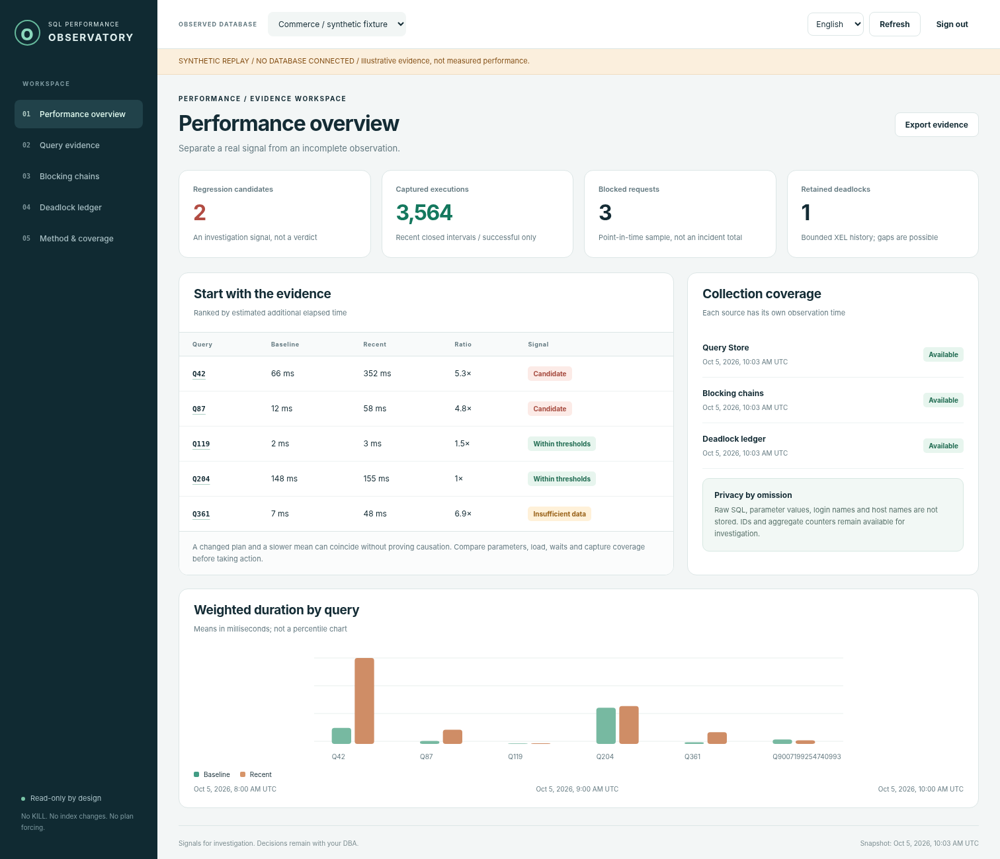
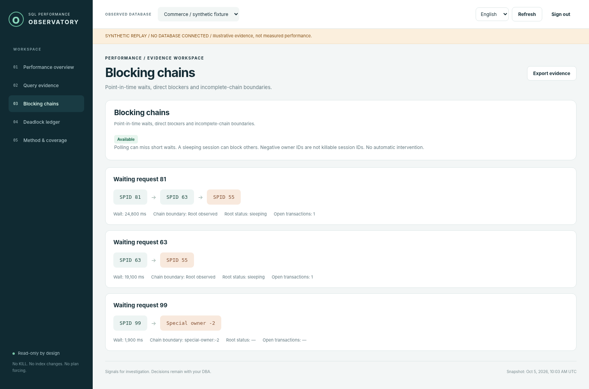

# SQL Server Performance Observatory

**Understand the slowdown. Keep control of the fix.**

[Deutsch](README.de.md) · [Architecture](docs/en/architecture.md) · [Measurement method](docs/en/methodology.md) · [Local SQL lab](docs/en/lab-guide.md) · [Verification status](docs/en/testing.md)

An independent, read-only diagnostic workspace built with **C# 14, ASP.NET Core 10 and Microsoft.Data.SqlClient**. It compares weighted Query Store observations, tracks plan identity changes, follows blocking chains and preserves sanitized deadlock evidence. English is the default interface language; German and Persian (RTL) are included.

> **Engineering preview: `0.1.0-preview.1`.** The delivered source has not been compiled or run on .NET/SQL Server in its preparation environment. Frontend/support checks were exercised with explicitly synthetic fixtures. CI and a guarded live SQL acceptance lab are supplied; see the precise [verification boundary](docs/en/testing.md). No passing-build badge or measured speedup is asserted.

> **CI follow-up (6 October 2026):** Uploaded logs confirm .NET builds and 51
> passing xUnit tests on each of Windows/Linux, plus 20 real ASP.NET API checks.
> The browser job exposed a test-side CSP/inspector mismatch, now corrected.
> [Read the diagnosis and remaining verification boundary](docs/en/ci-csp-fix.md).



*Actual frontend, synthetic fixture data. These figures are neither production telemetry nor a performance benchmark.*

## Why this project
A slow query is a symptom, not a complete diagnosis. A changed plan is a clue, not proof of causality. A missing sample is unknown, not zero. The project makes those distinctions visible and keeps production remediation under DBA control.

| Capability | What is actually implemented |
|---|---|
| Query evidence | Successful captured executions, weighted duration/CPU/logical reads, comparison of two closed windows, explicit sample thresholds. |
| Plan changes | Plan IDs/hashes, forced-plan flag and changed plan-set indication; no plan-tree diff. |
| Blocking | Request chains, sleeping roots, cycles, special negative owner IDs and incomplete boundaries. |
| Deadlocks | Existing XEL reader, bounded XML parsing, victim/resource ownership graph, content-based deduplication. |
| Coverage | Independent source states, last attempt/success, collection duration and row-limit warnings. |
| Privacy | No Query Store text or plan XML selected; raw deadlock XML is processed transiently but not stored/exported. |
| Operation | Read-only collector, opt-in server diagnostics, local snapshots, unsigned JSON evidence export. |
| Reproducibility | Separate local Developer lab: index-present / index-removed / index-restored with identical parameters, plus blocking/deadlock/permission contracts. |

No automatic tuning, arbitrary SQL, KILL, index changes or plan forcing in the web service. No AI diagnosis or invented p95 from Query Store aggregates. [Exact scope and roadmap](docs/en/roadmap.md).

## Start without SQL Server
Install the SDK in [global.json](global.json); the first restore requires an approved NuGet connection. No frontend package installation is needed.

```powershell
# In the repository root, on Windows:
powershell.exe -NoProfile -ExecutionPolicy Bypass -File .\scripts\build.ps1
if ($LASTEXITCODE -ne 0) { throw 'Build/tests failed. Review logs before proceeding.' }
powershell.exe -NoProfile -ExecutionPolicy Bypass -File .\scripts\run-demo.ps1
```

The second script prints a temporary random access key. Open `http://localhost:5080`, sign in and explore the explicitly labeled replay. Linux/macOS: `bash scripts/build.sh`, then `bash scripts/run-demo.sh`. These commands must succeed on your machine before claiming a working build. See [getting started](docs/en/getting-started.md).

## Connect deliberately
A dedicated SQL identity needs the version-specific Query Store grant. Blocking and XEL additionally need optional instance-level diagnostic grants; both are off by default. Production Query Store settings and XE sessions are never changed automatically. Connection strings stay server-side. Start with [permissions](docs/en/permissions.md) and [configuration](docs/en/configuration.md).

SQL Server 2019/2022 primary user databases are design targets; SQL Server 2022 Developer is the supplied laboratory target. These are not compatibility certifications. Azure-specific behavior, AG routing, HA, enterprise SSO and multi-user authorization are outside the preview.

## Repository map
```text
src/Observatory.Core/       Pure analysis, XML/chain normalization and state
src/Observatory.SqlServer/  Typed SQL adapters and four embedded read queries
src/Observatory.Web/        ASP.NET host, collector, authentication and static UI
tools/Observatory.Lab/     Separate guarded SQL mutation/measurement laboratory
tests/                    Authored xUnit, actual-server API/browser and support tests
sql/permissions/          DBA-reviewed grant templates
docs/en/ + docs/de/       Bilingual engineering and operational documentation
.github/workflows/        Build, native UI and opt-in live SQL acceptance
```

## Evidence, not marketing numbers
The local lab uses 100,000 deterministic synthetic rows, five warmups and thirty measured executions per phase. It records actual client samples and parsed logical reads and requires equal result sequences. No result has been prefilled. Read [the controlled experiment](docs/en/lab-guide.md) before running any write-capable tool.



## Engineering documentation
[Architecture](docs/en/architecture.md) · [Methodology](docs/en/methodology.md) · [Permissions](docs/en/permissions.md) · [Configuration](docs/en/configuration.md) · [Security](docs/en/security.md) · [Operations](docs/en/operations.md) · [API](docs/en/api.md) · [Testing](docs/en/testing.md) · [Lab](docs/en/lab-guide.md) · [Portfolio](docs/en/portfolio.md) · [Publishing](docs/en/publishing.md) · [Roadmap](docs/en/roadmap.md) · [Decisions](docs/adr/README.md).

## Additional analysis
[Persian technical analysis](docs/ANALYSIS.fa.md).

## Sources and licensing
Microsoft's [Query Store management guidance](https://learn.microsoft.com/en-us/sql/relational-databases/performance/manage-the-query-store?view=sql-server-ver17), [runtime-statistics contract](https://learn.microsoft.com/en-us/sql/relational-databases/system-catalog-views/sys-query-store-runtime-stats-transact-sql?view=sql-server-ver17), [DMV documentation](https://learn.microsoft.com/en-us/sql/relational-databases/system-dynamic-management-objects/sys-dm-exec-requests-transact-sql?view=sql-server-ver17) and [system_health guidance](https://learn.microsoft.com/en-us/sql/relational-databases/extended-events/use-the-system-health-session?view=sql-server-ver17) inform the adapter boundaries. The [SDK](https://dotnet.microsoft.com/en-us/download/dotnet/10.0) and [SqlClient LTS release](https://learn.microsoft.com/en-us/sql/connect/ado-net/microsoft-data-sql-client-release-notes?view=sql-server-ver17) were checked on 5 October 2026.

Original source is [MIT licensed](LICENSE). SQL Server and external packages retain their own terms. No Microsoft endorsement, certification, customer deployment or performance guarantee is claimed. See [third-party notices](THIRD_PARTY_NOTICES.md), [contribution guide](CONTRIBUTING.md) and [security reporting](SECURITY.md).
