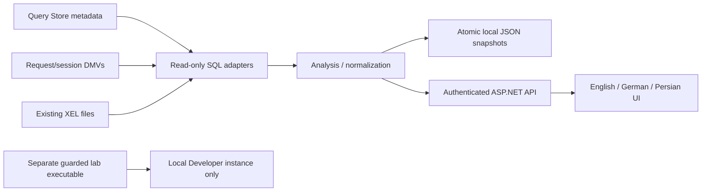

# Architecture and boundaries

[Project](../../README.md) | [Deutsch](../de/architecture.md)

## Design goal
Explain observed SQL Server behavior without granting the web application authority to tune production. This is a modular monolith, not a microservice demonstration. One deployable process and one bounded local state directory keep an evaluation understandable.

| Module | Responsibility | Forbidden dependency |
|---|---|---|
| `Observatory.Core` | Weighted aggregation, evidence classification, chain and XML parsing, local snapshots. | ASP.NET and SQL connection code. |
| `Observatory.SqlServer` | Four embedded SELECT queries, typed parameters, explicit source bounds. | UI, lab mutation scripts. |
| `Observatory.Web` | Authentication, configuration, independent target loops, JSON API and static UI. | `Observatory.Lab`. |
| `Observatory.Lab` | Create synthetic data; induce and repair a local regression; exercise concurrency. | Production deployment. |

## Collection lifecycle
There is one serial loop per configured target (1..8); it never overlaps queries for that target. Query Store, blocking and XEL have independent periods, status, last success and backoff. A failing source retains old observations but changes its status to `error`. The UI shows unknown instead of a healthy zero for unavailable counters. A new process marks recovered state pending until recollection.

A Query Store collection replaces counters; it is not added to the previous collection. This prevents repeated polling from double-counting the same interval. Each successful state change is written before publication to the in-memory catalog. Disk errors stop the background host rather than report an unpersisted healthy sample.

## Persistence
`SnapshotStore` uses a single-writer file lease, temporary files and same-directory replacement. Latest snapshots are replaced; an archive is kept approximately every 15 minutes with 48 entries per target by default. The application reads latest state after restart. Historical JSON files can be inspected offline; there is no historical browsing API/UI yet.

This is not a replicated database or an append-only audit ledger. Local filesystem guarantees, secure directory ownership and backup discipline are assumed. Network filesystems, multi-node HA, filesystem tampering and crash durability across all operating systems are not certified.

Target identity includes a hash of the configured server/database. A changed endpoint does not silently inherit old observations. A database replaced at the same endpoint/name is not reliably distinguished: clear/archive its target state under change control. Query IDs are scoped to a database and collection, not globally unique.

## Intended scope
SQL Server 2019 and 2022 primary user databases, one trusted analyst per installation, internal HTTPS deployment. SQL Server 2022 Developer is the reference acceptance-lab configuration. These are design targets, not executed compatibility certifications. Azure SQL Database, Managed Instance, Synapse, Availability Group routing, SQL Server 2025-specific behavior and HA are outside this preview's qualified scope.

See [testing](testing.md), [security](security.md) and the [decision records](../adr/README.md).
